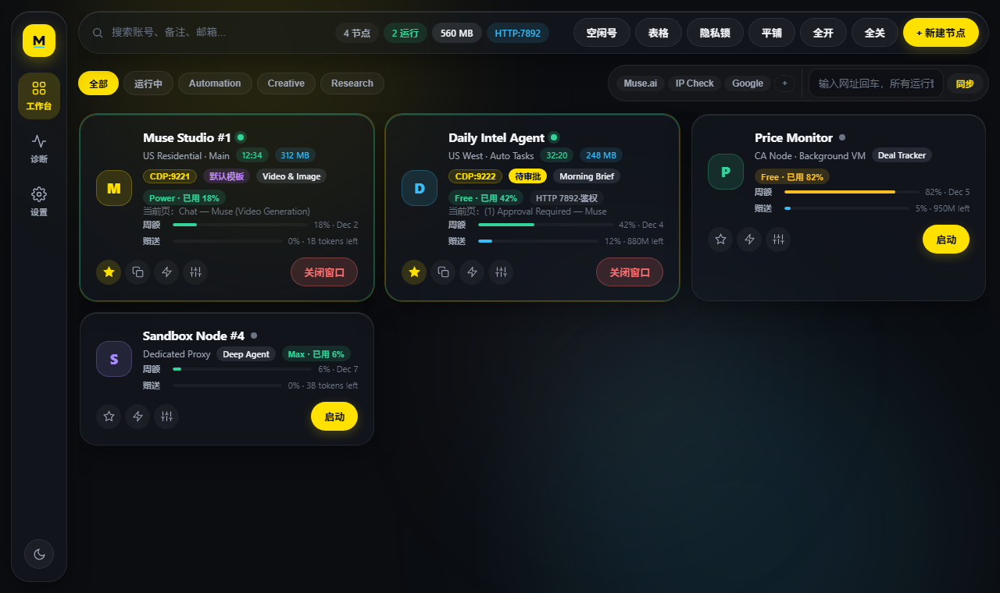
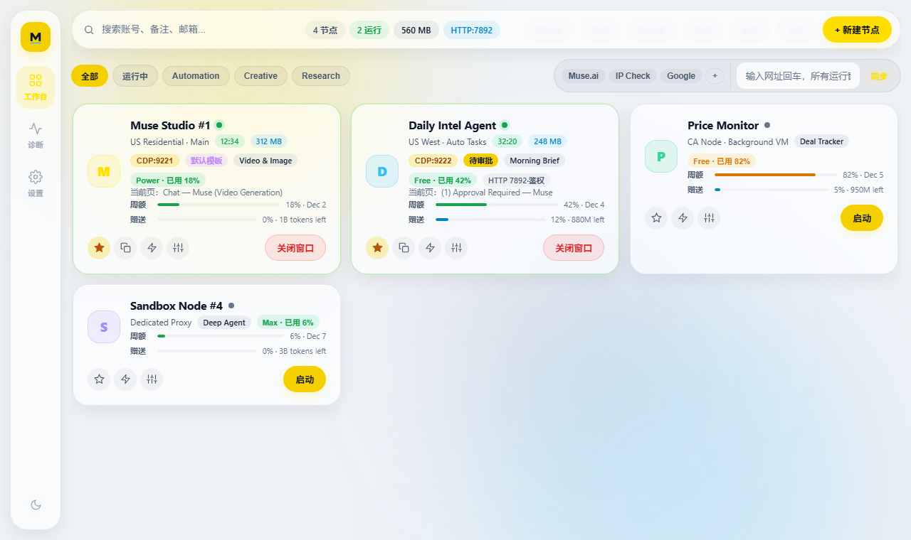

# MuseDeck

<p align="center">
  <strong>Lightweight (~14 MB) Local Multi-Account Command Deck & Agent Browser Pool for Meta Muse (muse.ai) and AI Workflows</strong>
</p>

<p align="center">
  <a href="./README_CN.md">简体中文</a> ·
  <a href="#features">Features</a> ·
  <a href="#quick-start">Quick Start</a> ·
  <a href="#local-agent-api">Local Agent API</a>
</p>

<p align="center">
  
  
  
  
</p>

---

<p align="center">
  
</p>

<details>
<summary>Preview Clean Light Theme</summary>
<br />
<p align="center">
  
</p>
</details>

**MuseDeck** is a privacy-first, local-only Windows desktop command deck built with **Python + native Windows WebView2**. Instead of bundling a bloated 300 MB custom browser, it orchestrates your native Chrome / Edge into completely isolated workspaces with frosted-glass Material Design 3 ergonomics, automatic **Meta Muse weekly & additional token quota tracking**, **same-IP conflict protection**, and a built-in **CDP + Local HTTP API** for AI agents.

## Features

- **Automatic Muse Quota Dual-Bar Tracking**: Reads both **Weekly Plan Usage** (e.g. `Free · 0% · Dec 2`) and **Additional Tokens** (`1B tokens left`) directly from Muse via CDP—supporting silent background refresh (`--headless=new`) without popping up browser windows.
- **Smart Idle-Node Launcher**: One click launches the next idle account with the lowest weekly token usage.
- **Agent Roles (Soul) & Quick Prompts**: Assign dedicated Agent roles (e.g. *Video Creator*, *Daily Brief*, *Price Watcher*) and store reusable Soul / task prompts with one-click copy.
- **Background Approval & Login Alerts**: Monitors active CDP tab titles to surface pulsing **Approval / New Activity** badges and **Session Expired** warnings without switching windows.
- **Same-IP Conflict Guard & Authenticated Proxies**: Supports HTTP/SOCKS5 proxies with `username:password` (auto-generated local auth helper extension), WebRTC leak prevention, and blocks accidental same-IP launches across active accounts.
- **Slide-Over Inspector & Dual Views**: Switch seamlessly between frosted-glass **Card Grid** and high-density **Monitor Table**, with a slide-over right drawer for credentials, lightweight Cookie session export/import, default extension template inheritance, and one-click window tiling.
- **Pure Native Mode & Privacy PIN Lock**: Toggle CDP off anytime for 100% unmodified native Chrome launches; lock/blur sensitive account details with a PIN before screen sharing.

## Quick Start

### Option 1: Portable Executable (Recommended)
Download `MuseDeck.exe` from [Releases](../../releases) and double-click to run. All data stays locally in `DeckData/`.

### Option 2: Run from Source
```powershell
pip install -r requirements.txt
python main.py
```

### Run Tests
```powershell
python -m unittest discover -s tests -v
```

## Local Agent API

When enabled (default), MuseDeck exposes a localhost-only REST API on `127.0.0.1:18900` so Playwright, n8n, or your AI Agents can control already-authenticated isolated browser nodes:

| Method | Endpoint | Description |
| :--- | :--- | :--- |
| `GET` | `/api/health` | Service health and version check |
| `GET` | `/api/nodes` | List all nodes with live status, memory usage, page title, and CDP port |
| `POST` | `/api/nodes/<id>/start` | Launch an isolated node and return its CDP endpoint |
| `POST` | `/api/nodes/<id>/stop` | Gracefully close the node window asynchronously |

## Disclaimer

MuseDeck is an independent, local-only open-source utility and is not affiliated with or endorsed by Meta or Muse. All profiles, credentials, and cookies are stored strictly on your local machine and are never uploaded.

## License

[MIT](./LICENSE)
